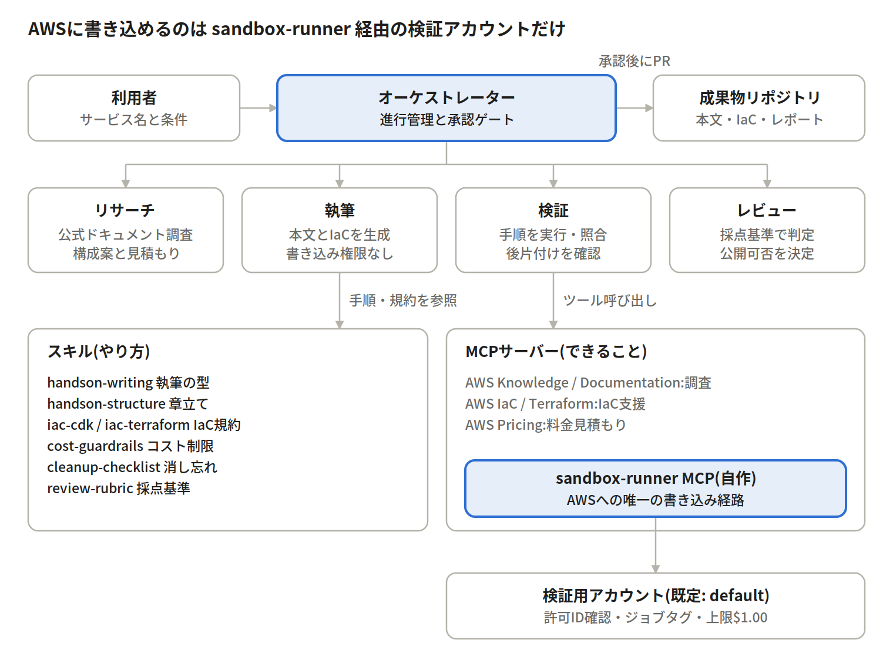
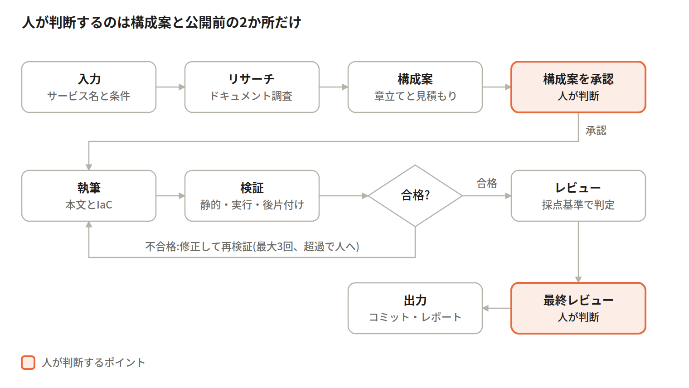
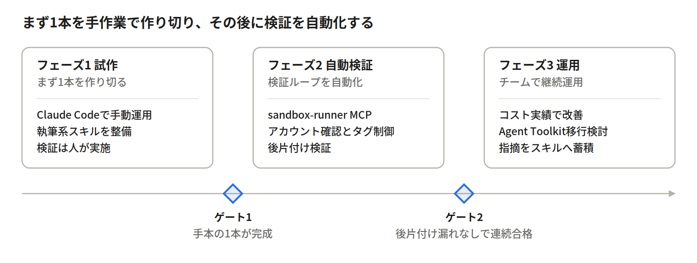

# AWSハンズオン自動生成エージェント 設計書

## 概要とゴール

AWSのサービス名(例: Amazon SQS)を渡すと、実際に動作確認済みのハンズオン教材一式を生成するエージェントを作る。ポイントは「書いて終わり」にせず、サンドボックス環境で手順を実行し、通ったものだけを成果物にすることにある。

成果物は次の4点とする。

- ハンズオン本文(Markdown): 目的、前提、所要時間、手順、確認ポイント、クリーンアップ
- 手順で作るリソースのIaCコード(CDKまたはCloudFormation)と、手順中のCLIコマンド
- 想定コストと削除手順
- 検証レポート: どの手順をいつ・どのリージョンで実行し、結果がどうだったか。末尾に使用トークン数と想定コスト、AWS検証費用の見積もりを載せる

成功の定義は「第三者が本文どおりに操作して最後まで完了でき、クリーンアップ後にリソースが残らないこと」。

## 前提と要件

2026年10月10日の確認で、以下の要件が確定した。

| 項目 | 決定内容 |
| --- | --- |
| 受講者 | 社内エンジニア |
| 入力 | サービス名(必須)、テーマや対象レベル、所要時間、IaC種別、AWSプロファイル、リージョン(任意) |
| 出力形式 | Gitリポジトリに置くMarkdown + IaCコード + 実行レポート |
| IaC | CDK(TypeScript)とTerraformから選択。未指定時はCDK |
| 検証用AWSアカウント | 既定は `~/.aws/credentials` の `default` プロファイル(検証専用アカウント)。プロンプトで指定があればそのプロファイルに切り替える |
| 検証リージョン | 既定は ap-northeast-1。プロンプトで指定があればそれに従う |
| 検証費用の上限 | 1本あたり$1.00 |
| 実行基盤 | 手元のClaude Code(サブエージェント機能) |
| 実行レポート | 生成に使ったトークン数とその想定コストを最後に出力する。金額はUSD表示 |
| 人の関与 | 構成案の承認と、公開前の最終レビューの2か所 |

非機能要件として、AWS費用・トークン費用・実行時間の3つに上限を持ち、どれかを超えた時点で検証を止めて後片付けに入る。

## 全体アーキテクチャ

オーケストレーター1つの下に、役割を分けた4つのサブエージェントを置く。役割ごとに持てるツールを変え、AWSに書き込めるのは検証担当だけにする。



実行基盤は手元のClaude Codeとする。オーケストレーターはスラッシュコマンド(例: `/handson <サービス名> [--iac cdk|terraform] [--profile <名前>] [--region <リージョン>]`)として定義し、4つの担当は `.claude/agents/` のサブエージェントとして、それぞれに使ってよいツールとMCPサーバーを限定する。スキルは `.claude/skills/`、MCP接続はリポジトリ直下の `.mcp.json` にまとめ、リポジトリをcloneすれば誰でも同じ構成で動くようにする。

## ワークフロー

最初に構成案だけを作って人が承認し、その後の執筆と検証は自動で回す。題材や見積もりがずれたまま執筆・検証に進むと、時間とAWS費用が無駄になるためである。



各ステップの成果物(構成案、本文、検証ログ)はファイルとして残し、次のステップはそれを読んで始める。途中で止まってもそこから再開でき、サブエージェントのコンテキストも小さく保てる。

## ツールとMCPサーバー構成

情報収集と構築支援はAWS公式のMCPサーバーを使い、「サンドボックスでの実行と後片付け」だけを自作MCPサーバーにする。AWS環境に書き込める経路を自作サーバー1つに絞ることで、権限と監査を集中管理できる。

| 用途 | サーバー | 使う担当 | 書き込み |
| --- | --- | --- | --- |
| 最新ドキュメント、What's New、Getting Started、Well-Architected | [AWS Knowledge MCP Server](https://github.com/awslabs/mcp/blob/main/src/aws-knowledge-mcp-server)(AWSホストのリモート) | リサーチ、執筆 | なし |
| ドキュメント・APIリファレンスの詳細取得 | [AWS Documentation MCP Server](https://github.com/awslabs/mcp/blob/main/src/aws-documentation-mcp-server) | リサーチ | なし |
| CDK/CloudFormationのベストプラクティス、テンプレート検証 | [AWS IaC MCP Server](https://github.com/awslabs/mcp/blob/main/src/aws-iac-mcp-server) | IaC生成(CDK選択時) | なし(検証のみ) |
| Terraform AWSプロバイダーのドキュメントとベストプラクティス | AWS Terraform MCP Server(awslabs) | IaC生成(Terraform選択時) | なし |
| 料金の見積もり | AWS Pricing MCP Server | 設計、検証前チェック | なし |
| 手順の実行、リソースの棚卸し、強制削除、費用見積もり | 自作 sandbox-runner MCP | 検証 | あり(ジョブタグ付きリソースのみ) |
| 手元のGitリポジトリへのコミット | Claude Code組み込みのBash(git) | 公開 | あり(人の承認後) |

自作の sandbox-runner には、`run_step`(1手順を実行して出力を返す)、`list_tagged_resources`(このジョブのタグが付いたリソース一覧)、`teardown`(ジョブのリソースを全削除。CDKは `cdk destroy`、Terraformは `terraform destroy` の後にタグで残骸を掃除)、`estimate_job_cost`(作成予定・作成済みリソースと経過時間から費用を見積もる)の4ツールを持たせる。認証は `default` プロファイルをそのまま使い、全リソースに `handson-job-id` タグを付けることを必須にする。

選定時の注意: awslabs/mcp のREADMEでは、2026年5月に公開された [Agent Toolkit for AWS](https://aws.amazon.com/about-aws/whats-new/2026/05/agent-toolkit/) が既存のMCPサーバー・スキル群の後継と案内されている。エージェントの操作を人と区別するIAM条件キーなどを備えるため、本番化の段階では乗り換えを検討する。また AWS MCP Server(プレビュー)はKnowledgeとAPI操作を統合した選択肢だが、プレビュー中のため初期構成では採用しない。([source](https://github.com/awslabs/mcp))

## スキル設計

「何ができるか」はMCPに、「どう書くか・どう判断するか」はスキルに分ける。品質を左右するのはスキル側で、チームのノウハウが溜まるのもここになる。

| スキル | 中身 | 読み込むタイミング |
| --- | --- | --- |
| handson-writing | 構成テンプレート、1手順1操作の原則、確認ポイントの書き方、社内エンジニア向けの文体ルール | 執筆時 |
| handson-structure | レベル別の章立て例(入門60分、応用120分など)と良い題材の選び方 | 構成案の作成時 |
| iac-cdk | CDK(TypeScript)のバージョン、ディレクトリ構成、命名規則、`RemovalPolicy.DESTROY` の徹底、ジョブタグの付与 | CDK選択時のIaC生成 |
| iac-terraform | Terraformのバージョン、プロバイダー固定、`default_tags` でのジョブタグ付与、stateはジョブディレクトリ内にローカル保存 | Terraform選択時のIaC生成 |
| cost-guardrails | 1本$1.00の上限、使用禁止または要承認のサービスとインスタンスタイプ、無料枠の扱い | 構成案の作成時、検証前 |
| cleanup-checklist | サービスごとの消し忘れやすいリソース(ENI、ログループ、スナップショットなど) | 検証とクリーンアップ時 |
| review-rubric | 公開可否の採点基準(再現性、正確性、コスト明記、削除手順) | レビュー時 |

ハンズオン本文は同じ構成のまま、IaCの章とコマンドだけをCDK版とTerraform版で差し替えられるように、本文テンプレートにIaC依存部分の差し込み箇所を設けておく。

各スキルは `SKILL.md` + テンプレートやサンプルの同梱ファイルで構成する。最初は良いハンズオン1本を手本として handson-writing に同梱し、レビューで出た指摘を随時スキルへ追記していく運用にする。

## 品質保証

品質の要は「書いた手順を、書いた本人ではない検証担当が本文だけを見て実行する」ことにある。執筆担当の頭の中にある前提が本文に書かれていないと、ここで失敗として検出される。

検証は3段階で行う。

1. 静的チェック: CLIコマンドの構文、IaCのsynthとテンプレート検証、本文とコードでリソース名が一致しているか
2. 実行検証: サンドボックスで手順を上から順に実行し、各手順の「確認ポイント」に書いた期待結果と実際の出力を照合する
3. 後片付け検証: クリーンアップ手順の実行後、ジョブタグ付きのリソースが0件であることを確認する。残れば失敗扱い

失敗した場合は、失敗した手順・エラー出力・直前の状態を執筆担当に返して修正させ、再検証する。ループは最大3回とし、超えたら人にエスカレーションする。コンソール操作の手順は自動実行できないため、同等のCLI操作で代替検証し、レポートに「CLI代替で検証」と明記する。

最後にレビュー担当が review-rubric で採点し、基準を満たしたものだけを人の最終レビューに回す。

## トークン使用量と想定コストの算出

成果物の生成が終わったら、最後に「実行レポート」を出力し、Claude側のトークン数と想定コスト、AWS側の想定費用を1つの表にまとめる。計測にはClaude Code標準のOpenTelemetry出力を使い、自前でトークンを数える処理は作らない。

計測の流れは次のとおり。

1. `.claude/settings.json` の `env` で `CLAUDE_CODE_ENABLE_TELEMETRY=1` とOTLPの送信先(手元で動かすOpenTelemetry Collector)を設定する
2. Collectorは受け取った `claude_code.api_request` イベントと `claude_code.token.usage`・`claude_code.cost.usage` メトリクスを、ジョブディレクトリのJSONファイルに書き出す
3. オーケストレーターは各フェーズの開始・終了時刻をジョブログに記録する
4. 最後に集計スクリプトが、セッションIDと時刻でイベントをフェーズに振り分けて合計し、レポートを生成する

レポートの出力イメージ:

```markdown
## 実行レポート(job: sqs-intro-20261010-01)

| フェーズ | 入力 | 出力 | キャッシュ読込 | キャッシュ作成 | 想定コスト(USD) |
| --- | --- | --- | --- | --- | --- |
| リサーチ・構成案 | … | … | … | … | $… |
| 執筆 | … | … | … | … | $… |
| 検証(再試行 n回を含む) | … | … | … | … | $… |
| レビュー | … | … | … | … | $… |
| 合計 | … | … | … | … | $… |

AWS検証費用(見積もり): $… / 上限 $1.00
```

Claude Codeが出すコストはAPI料金に基づく推計値で、Pro/Maxプランでは実際の請求とは一致しない。そのためレポートでは「API料金換算の想定コスト」と表記し、正確な請求額はClaude Consoleで確認する旨を添える。OpenTelemetry出力はベータ機能のため、項目名が変わった場合に備えて集計スクリプトは項目名を設定で差し替えられるようにする。([monitoring](https://docs.claude.com/en/docs/claude-code/monitoring-usage), [costs](https://code.claude.com/docs/en/costs?ref=t01.li))

## セキュリティとコスト管理

検証は既定で `default` プロファイルの検証専用アカウントを使い、プロンプトで別のプロファイルが指定された場合はそちらに切り替える。どのアカウントでも同じ守りが効くよう、Claude Codeの権限設定、sandbox-runnerのタグチェック、費用の見積もりストップの3層で被害範囲を限定する。

- 開始時に、使用するプロファイル・アカウントID(`aws sts get-caller-identity` で取得)・リージョンを構成案の冒頭に明記し、構成案の承認時に人が確認する。指定がなければ `default` と ap-northeast-1 を使う
- sandbox-runner はジョブ開始時に受け取ったプロファイルとリージョンに固定し、ジョブの途中では切り替えない
- `.claude/settings.json` の permissions で、サブエージェントからの `aws`・`cdk`・`terraform` コマンドの直接実行を deny し、AWSへの変更は sandbox-runner 経由に限定する
- sandbox-runner は、変更・削除の対象に `handson-job-id` タグが付いていることを確認してから実行する。タグのない既存リソースには触れない
- 取りこぼし対策は、タグ付きで24時間以上経過したリソースだけを消すスクリプトにする。アカウント全体を掃除する aws-nuke 系のツールは使わない
- 全操作はCloudTrailに記録され、検証レポートのジョブIDから追跡できるようにする

### 検証費用 $1.00の管理

AWSの請求データは反映に時間がかかるため、実績ではなく見積もりで止める。

1. 構成案の時点でPricing MCPを使って見積もり、上限の8割を超える構成は却下して作り直す
2. 検証中は `estimate_job_cost` で経過時間込みの見積もりを手順ごとに更新し、$1.00に届く前に `teardown` する
3. 時間課金のリソースがある構成では、検証全体の実行時間に上限(初期値60分)を設ける
4. 実績額はコスト配分タグで後日確認し、必要ならレポートに追記する。Cost Explorer APIは呼び出しごとに課金されるため、自動では呼ばない

見積もりとレポートの金額はすべてUSDで表示し、円への換算は行わない。上限は$1.00とし、設定ファイルの値で判定する。

外部から取得したドキュメントやブログ本文はデータとして扱い、そこに書かれた指示をエージェントが実行しないよう、執筆担当には書き込み系ツールを持たせない。

## 実装ロードマップ

最初から全自動を目指さず、手元のClaude Codeで良いハンズオン1本を作るところから始める。その1本がスキルの手本になり、自動検証のテストケースにもなる。



各フェーズの期間は体制次第のため未設定。ゲートを満たしてから次に進む。

## 残課題

残課題はない。確定した要件はすべて「前提と要件」の表に反映済み。

今後の変更は「前提と要件」の表を更新して管理する。

## Sources

- [awslabs/mcp — Open source MCP servers for AWS](https://github.com/awslabs/mcp)
- [Agent Toolkit for AWS(What's New, 2026年5月)](https://aws.amazon.com/about-aws/whats-new/2026/05/agent-toolkit/)
- [Claude Code: Monitoring usage(OpenTelemetry)](https://docs.claude.com/en/docs/claude-code/monitoring-usage)
- [Claude Code: Manage costs](https://code.claude.com/docs/en/costs?ref=t01.li)
